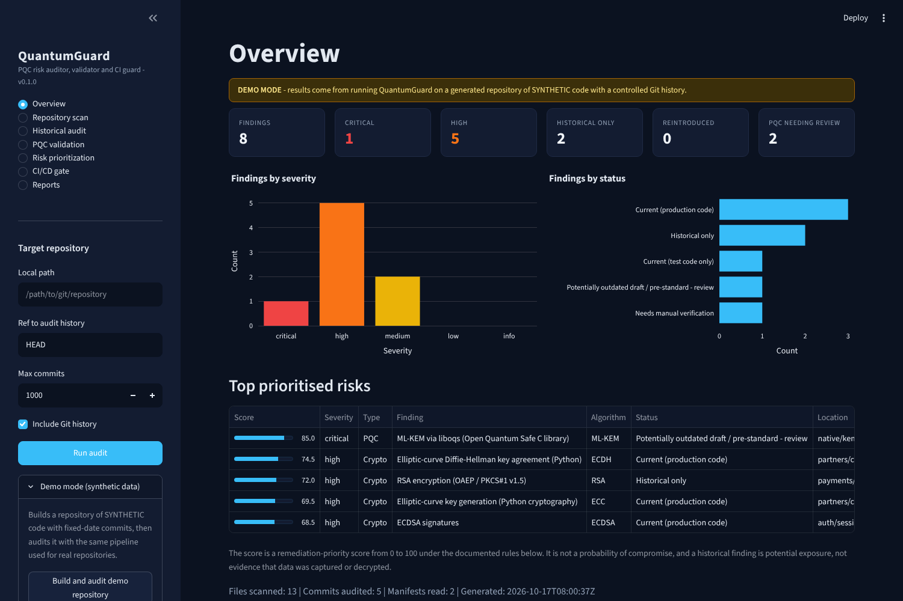

# QuantumGuard

**Quantum-safe cryptography risk auditor, PQC validator and CI/CD guard** - a hackathon prototype.

QuantumGuard connects four capabilities into one evidence-driven workflow:

1. **Discover** quantum-vulnerable cryptography (RSA, ECC, ECDH, DH, ECDSA, EdDSA, embedded classical keys) in current code **and** in Git history - including when a pattern first appeared, was removed, and came back.
2. **Validate** whether post-quantum code uses a *draft* or *final* implementation (NIST FIPS 203 ML-KEM, FIPS 204 ML-DSA), using only cited version evidence.
3. **Prevent** configured unsafe patterns from entering (or re-entering) the codebase through a GitHub Actions pull-request gate.
4. **Prioritise** remediation with an explainable 0-100 score where every factor is labelled as fact, user-supplied, assumption or unknown.

None of these capabilities is new on its own - cryptographic inventory tools, SAST rules, dependency scanners and CI gates already exist. The prototype's contribution is the **connection**: the history auditor feeds the CI gate (so a removed pattern that returns is blocked as a reintroduction), and history, PQC evidence and data sensitivity all feed one transparent priority score. It is designed to complement, not replace, existing discovery and migration tools.



## Quick start

Requires Python 3.11+ and git.

```bash
cd quantumguard
python -m venv .venv && source .venv/bin/activate      # Windows: .venv\Scripts\activate
pip install -r requirements.txt

python -m pytest -q                                      # 92 tests
streamlit run app.py                                     # dashboard on http://localhost:8501
```

In the dashboard sidebar open **Demo mode (synthetic data) -> Build and audit demo repository**, or enter the path of any local Git repository and press **Run audit**.

### Command line

```bash
python -m quantumguard demo /tmp/qg-demo --force                 # build the synthetic demo repo
python -m quantumguard audit /tmp/qg-demo --json r.json --csv r.csv --md r.md
python -m quantumguard history /tmp/qg-demo                       # timeline only
python -m quantumguard pqc /tmp/qg-demo                           # PQC validation only
python -m quantumguard ci --repo /tmp/qg-demo --base main --head feature/legacy-partner-rsa
echo $?                                                           # 1 = blocked
python -m quantumguard ci --repo . --base main --worktree         # gate your uncommitted changes
```

CI exit codes: `0` pass (warnings allowed), `1` blocked, `2` tool or usage error.

## Features

| Area | What it does |
|---|---|
| Current-code scanner (`scanner.py`) | 15 regex rules in `config/crypto_rules.json` for Python, Java/Kotlin, Go, JS/TS and PEM files. Strips comments and Python docstrings before matching, marks test paths, honours `quantumguard: ignore`, skips binaries, symlinks, dependency/venv/build folders, generated files and oversized files. |
| Historical auditor (`git_history.py`) | Walks first-parent history, rescans each changed file at each commit with the *same* scanner, and records introduced / removed / reintroduced events, exposure windows and current vs historical-only status. Findings are tracked by a fingerprint (rule + file + normalised code), so moved lines and whitespace edits do not create false events. |
| PQC validator (`pqc_validator.py`) | Parses `requirements*.txt`, `pyproject.toml`, `package.json`, `go.mod`, `Cargo.toml`, CMake `FetchContent`/`ExternalProject`, `vcpkg.json` and `conanfile.txt`; finds Kyber / ML-KEM / Dilithium / ML-DSA identifiers in code; links code to the nearest manifest of a matching language; applies cited version rules in `config/pqc_library_rules.json`. Results: *Potentially outdated draft*, *Aligned with final standard*, or *Needs manual verification*, each with a confidence level (verified / partial / unknown / synthetic). |
| Risk engine (`risk_engine.py`) | Configurable factors in `config/risk_policy.json`: algorithm risk, operation (harvest-now-decrypt-later exposure), data sensitivity, current presence, exposure duration, reintroduction, plus PQC status/confidence/usage. Every factor has points, maximum, basis and reason. Adjustable from the dashboard without code changes. |
| CI/CD gate (`policy_engine.py`) | Gates only lines added by the change, blocks or warns per `config/ci_policy.json`, flags reintroductions using the base branch's history, checks PQC changes, emits GitHub annotations and a job summary. |
| Reports (`report_generator.py`) | JSON (full evidence), CSV (spreadsheet-injection safe) and Markdown. |
| Dashboard (`app.py`) | Overview, Repository scan, Historical audit (exposure-window timeline), PQC validation, Risk prioritization (factor breakdown), CI/CD gate (run the gate on any two refs), Reports. |

## Architecture

See [docs/architecture.md](docs/architecture.md) for the diagram and data flow.

```
quantumguard/
  app.py                       Streamlit dashboard
  config/                      crypto_rules.json, pqc_library_rules.json, risk_policy.json, ci_policy.json
  quantumguard/
    scanner.py                 shared detection engine
    git_history.py             historical auditor (read-only git)
    pqc_validator.py           draft-vs-standard validator
    risk_engine.py             explainable scoring
    policy_engine.py           CI gate
    pipeline.py                joins scan + history + PQC + scoring
    report_generator.py        JSON / CSV / Markdown
    demo_builder.py            builds the synthetic demo repo
    cli.py, __main__.py        command line
  demo/templates/              synthetic demo code + plan.json (fixed commit dates)
  tests/                       pytest suite + labelled evaluation corpus
  scripts/evaluate.py          measured precision / recall / CI blocking / ranking
  scripts/make_test_report.py  writes docs/test_report.md from a real pytest run
  .github/workflows/quantumguard.yml
  docs/                        architecture, demo script, USPs, risk model, limitations, reports, screenshots
```

## Using the CI gate on GitHub

The workflow in `.github/workflows/quantumguard.yml` runs the tests and, on pull requests, runs:

```bash
python -m quantumguard ci --repo . --base "origin/${{ github.base_ref }}" --head HEAD --json quantumguard-ci.json
```

`fetch-depth: 0` is required so the gate can see history for the reintroduction check. To protect another repository, copy the `quantumguard/` package and `config/` folder into it (or check them out in a separate step), add the job, and mark the check as required in branch protection. The gate itself needs only the Python standard library.

**Test it on GitHub:** push this project to a repository, create a branch that adds `k = rsa.generate_private_key(public_exponent=65537, key_size=2048)` to a non-test `.py` file, and open a pull request - the `pqc-gate` job fails with an inline annotation. A branch that only adds a comment mentioning RSA passes.

**Test it locally:** `python -m quantumguard ci --repo . --base main --head <branch>` or, for uncommitted work, `--worktree`.

## Policies and configuration

- `config/crypto_rules.json` - detection rules and scan settings (extensions, excluded folders, test-path markers, size limits).
- `config/ci_policy.json` - `mode` (`enforce`/`warn`), operations and rules to block or warn, `allow_rules`, `test_paths` (`warn`/`ignore`/`same`), `block_reintroduced`, PQC decisions, `fail_on_warn`.
- `config/risk_policy.json` - all scoring weights, sensitivity defaults and severity thresholds ([docs/risk_model.md](docs/risk_model.md)).
- `.quantumguard.json` in a scanned repository may declare path sensitivity (`{"sensitivity": {"payments/": "high"}}`); it is labelled `repo_declared` in score explanations.

## Results

Measured by `python scripts/evaluate.py` (full report: [docs/evaluation_report.md](docs/evaluation_report.md)):

| Measure | Result |
|---|---|
| Precision on labelled corpus | 0.962 (25 TP, 1 FP) |
| Recall on labelled corpus | 0.862 (4 FN, all deliberate hard cases) |
| Unsafe synthetic changes blocked | 8 / 8 |
| Safe synthetic changes blocked | 0 / 6 |
| Documented risk scenarios ordered correctly | 21 / 21 pairs |

The corpus is small and synthetic; these are prototype sanity checks, not coverage claims. Test run: [docs/test_report.md](docs/test_report.md).

## Security and reliability

- Scanned repositories are untrusted input: files are only read, never executed or imported; symlinks are not followed.
- Git runs with argument lists (no shell), timeouts, prompts disabled, `core.fsmonitor=false`, no external diff or textconv drivers, and optional locks off. User-supplied refs are validated and resolved to a SHA before use, so they cannot be interpreted as git options. Git's `safe.directory` ownership check is left on.
- Nothing is uploaded; no network access is required.
- CSV cells that start with `=`, `+`, `-` or `@` are neutralised.
- The demo builder only deletes a directory it created itself (marker file).

## Limitations

Regex-based detection, no data-flow analysis, small rules database, first-parent history only, score is a ranking aid. Full list: [docs/limitations.md](docs/limitations.md).

## Documentation

- [docs/demo_script.md](docs/demo_script.md) - judge demo, step by step, with expected results
- [docs/usp_overview.md](docs/usp_overview.md) - the four USPs in short
- [docs/risk_model.md](docs/risk_model.md) - scoring factors and documented scenarios
- [docs/presentation_outline.md](docs/presentation_outline.md) - pitch outline
- [docs/screenshots/](docs/screenshots/) - captured from the running dashboard in demo mode

## References

- NIST FIPS 203, Module-Lattice-Based Key-Encapsulation Mechanism Standard (Aug 2024): https://csrc.nist.gov/pubs/fips/203/final
- NIST FIPS 204, Module-Lattice-Based Digital Signature Standard (Aug 2024): https://csrc.nist.gov/pubs/fips/204/final
- liboqs release notes: https://github.com/open-quantum-safe/liboqs/releases
- Go `crypto/mlkem` documentation: https://pkg.go.dev/crypto/mlkem@go1.24.0
