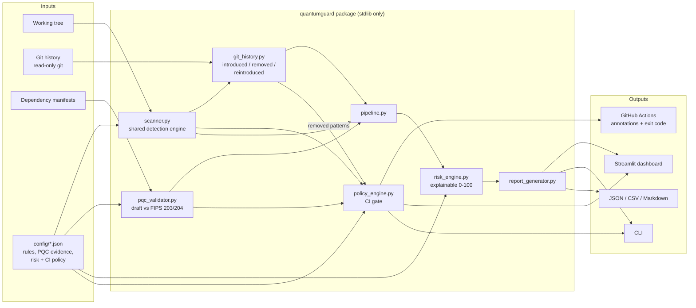

# Architecture



ASCII version (for slides):

```
 working tree --+                         +--> risk_engine --> reports / dashboard
                +--> scanner (shared) ----+
 git history ---+--> git_history ---------+
                         |  removed patterns
 PR diff ---------> policy_engine (CI) <--+--- pqc_validator <--- manifests + code
                         |
                         +--> exit code, annotations, job summary
```

## Data flow

1. **scanner.py** turns text into findings. It removes comments (and Python docstrings), matches the rules, and gives each finding a *fingerprint* (rule + path + normalised code) and a *signature* (rule + normalised code).
2. **git_history.py** lists first-parent commits with `git log --name-status`, reads each changed file at that commit with `git cat-file --batch`, runs the same `scan_text`, and diffs fingerprint counts per file. Count 0 -> n is *introduced* (or *reintroduced* if the fingerprint was removed before); n -> 0 is *removed*. Exposure windows are built from commit timestamps.
3. **pqc_validator.py** parses manifests into dependencies, finds PQC identifiers in code, links each identifier to the deepest manifest of a matching language, and evaluates cited version rules.
4. **pipeline.py** reads the working tree once, runs 1-3, merges current and historical findings by fingerprint into status classes (`current_production`, `current_test`, `historical_only`, ...), and calls the risk engine.
5. **risk_engine.py** adds factors, a score, a severity and the reasons.
6. **policy_engine.py** (CI) computes the merge-base, gets added line numbers from `git diff -U0`, reads the new file versions, scans them with `scan_text`, keeps findings on added lines, checks them against patterns removed in the base branch's history, re-runs PQC validation on the head tree, and applies `ci_policy.json`.

## Why these design choices

- **One detection engine** - the dashboard, history and CI can never disagree about what counts as a finding.
- **Full-file scan, then filter to changed lines** - comment and docstring context is correct even when only one line changed.
- **Fingerprints instead of line numbers** - history survives line moves and reformatting.
- **Standard library only in the core** - the CI job needs no dependency install, which keeps it fast and reduces supply-chain surface.
- **Evidence-first PQC rules** - a rule without a citation cannot produce "outdated"; missing evidence becomes "Needs manual verification".
